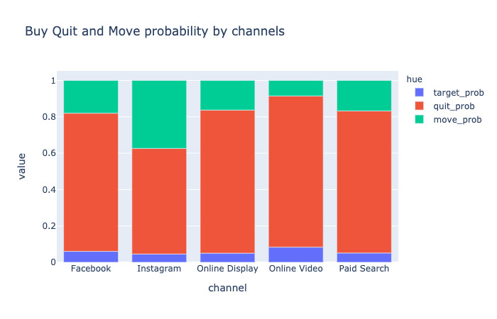
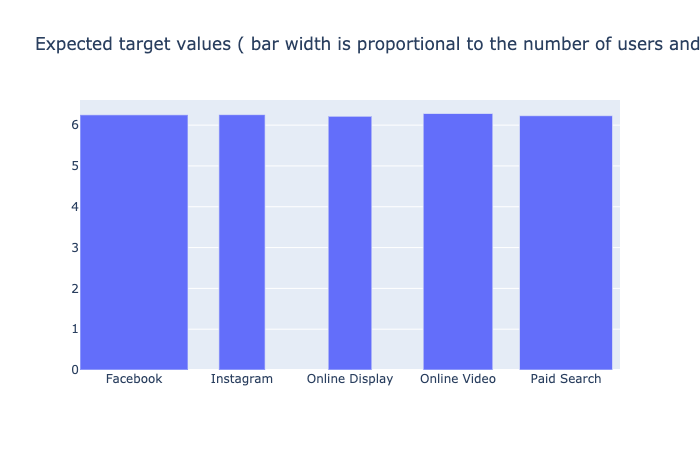
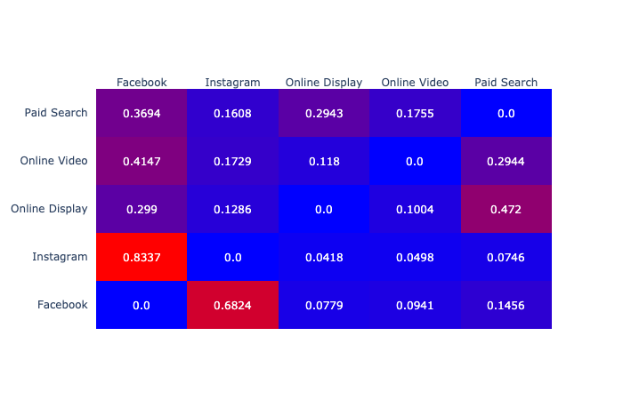
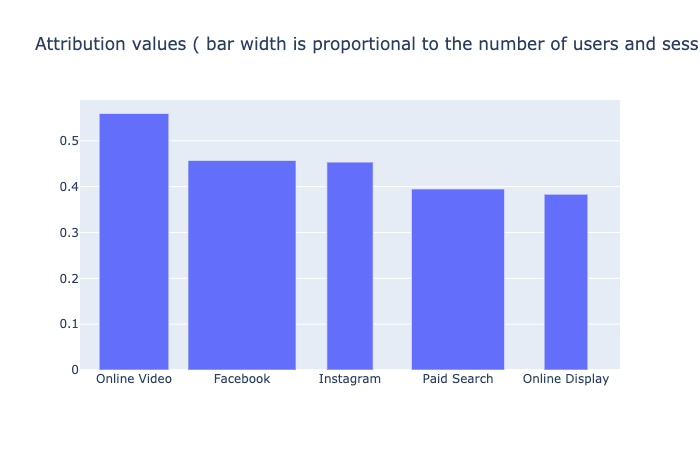

# iET
iterative Expected Target is a new algorithmic attribution model that based itself on the probability of reach your target both considering the single touchpoint effect and the probability to move the users to other touchpoint.
Similarly to the Markovian model attribution, iET evaluate the users transaction matrix redistributing the effect of a touchpoint to the others based on the proability to land on it.
Also, it doesn't require to specify of many baksteps are necessary to consider, because of the estimation process.
It could be use to evaluate a probability target (i.e. conversion rate) but also directly an economic measure like the transaction amount. 
The attribution values obtained with iET are in the same scale of the original target, making easy the comparison and the quantification of the impact of each touchpoint.


## INSTALL

`pip install iET`

## MODEL

Each touchpoint `s` is a state of an absorbing Markov chain: from `s` the journey reaches the target with probability `target_prob`, quits with `quit_prob` or moves to `s'` with `move_prob * P(s, s')`.
The iET value of a touchpoint is the expected target of a journey that is on it (Bellman equation of a Markov reward process):

`V(s) = target_prob(s) * xT(s) + move_prob(s) * sum_s' P(s, s') V(s')`

computed exactly as `V = (I - diag(move_prob) P)^-1 (target_prob * xT)`.
All the probabilities are estimated on the same set of journey steps; journeys are ordered by `time_colname`.
A step-by-step walkthrough on a small example (in Italian) is in [docs/algorithm.html](docs/algorithm.html).

## USAGE

```python
from iET.iET import iET

model = iET(touchpoint_colname='channel', target_colname='conversion_value', client_id_colname='cookie',
            time_colname='time', session_colname='session')
data = model.compute_session(data)           # optional: new session after a target or after max_delta_days of inactivity
model.estimate_proba(data)
values = model.estimate_attribution()         # iET value of each touchpoint (max_steps=k for a k-steps horizon)
removal = model.estimate_removal_effect()     # removal effect and total target attributed proportionally to it
ci = model.bootstrap(n_boot=100)              # bootstrap quantiles of the iET values
rows = model.compute_attribution(data, how='removal_effect')  # or how='attribution_values'
```

Options: `use_top_k` groups the less frequent touchpoints as `"Other"`, `alpha` adds Dirichlet smoothing to sparse counts,
`accept_consecutive_touchpoint` keeps repeated consecutive touchpoints as self transitions.

The iET value measures how valuable it is *to be* on a touchpoint, not its causal contribution: prefer the removal effect
to compare channels, and validate with experiments (holdout / geo tests) when possible.

## RESULTS 






